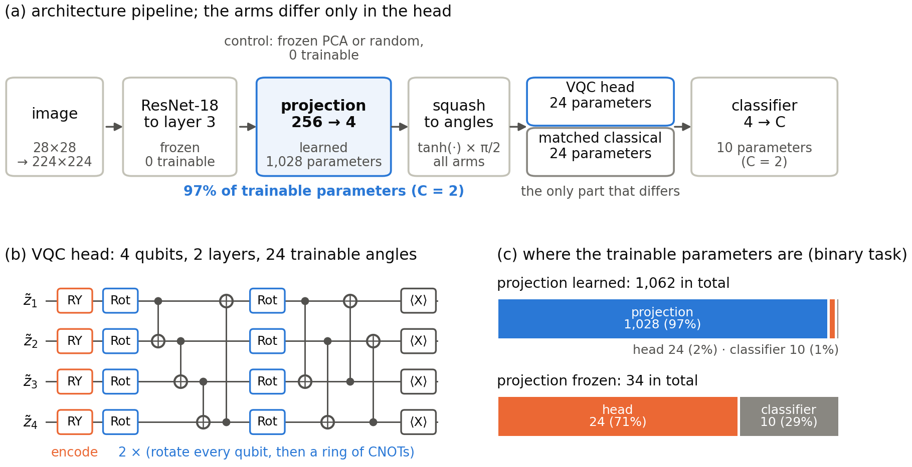
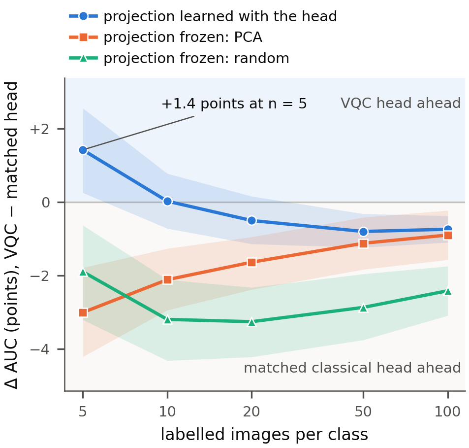
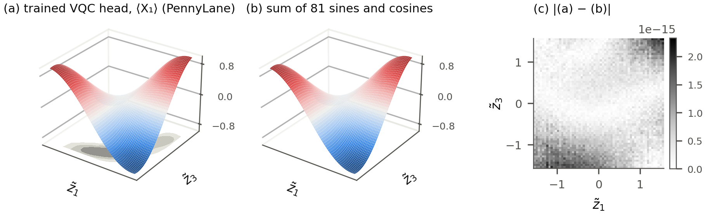
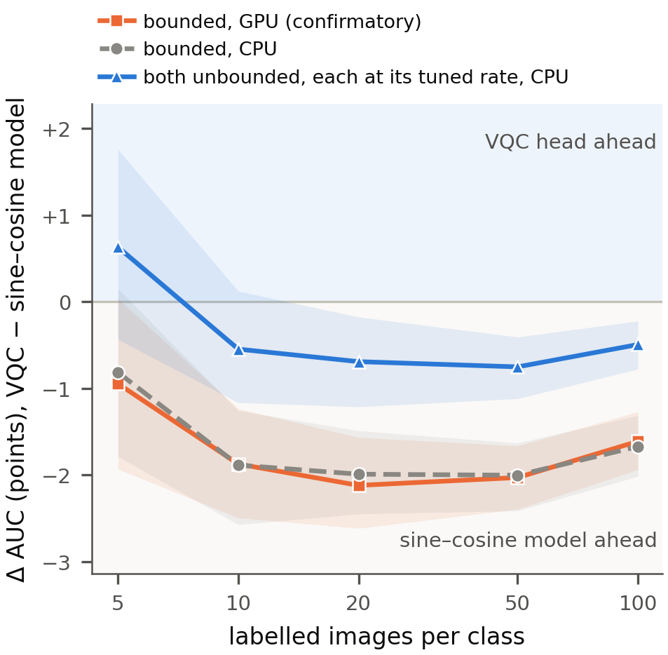
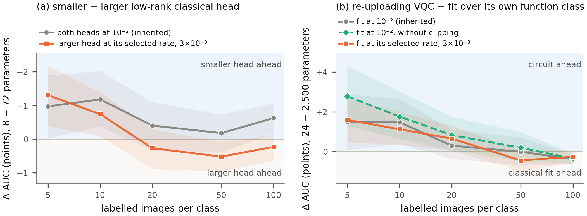
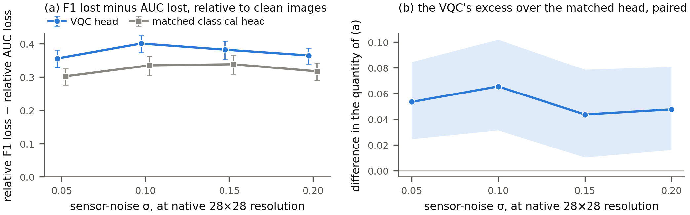
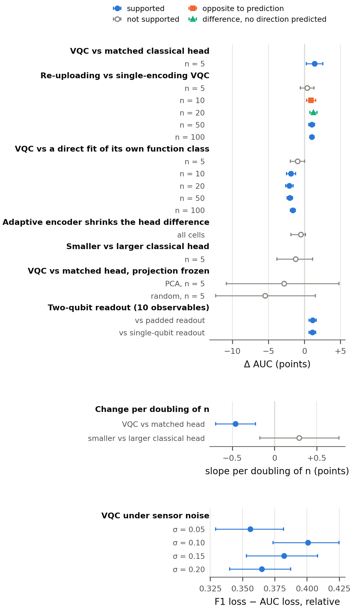

<h1 align="center">Where Does a Variational Quantum Head's Advantage Come From?</h1>
<h3 align="center">A Controlled Study of Medical Image Classification Under Data Scarcity</h3>

<p align="center">
Anish Felix Mathias · Susham P S · Rajashree Shettar · Badarinath Kamasetty
</p>

<p align="center">

<a href="https://doi.org/10.5281/zenodo.24465986"></a>
<a href="LICENSE"></a>

</p>

<p align="center">

</p>

Hybrid classifiers that put a small quantum circuit on top of a pretrained
network are often proposed for medical imaging, where labelled images are
scarce. When such a circuit beats a classical head, is the gain quantum?

We tested this on four MedMNIST datasets with **5 to 100 labelled images per
class**. A frozen ResNet-18 feeds a learned projection to four numbers, one per
qubit. Only the head changes between arms: a **24-parameter variational quantum
circuit (VQC)**, a classical head with **exactly the same 24 parameters**, and a
classical **sine–cosine model** of the 81 functions the circuit can compute.

**In short:** the VQC head does win, slightly, at 5 images per class. But the
win needs the projection in front of it to be trained with it, the circuit never
beats the classical model of its own function, and small classical heads show
the same "small beats large" pattern. The gain looks like **regularisation by a
small head, not quantum computation**. The results give no evidence of quantum
advantage.

> **What this is not.** The circuits have 4 to 16 qubits and run on a
> classical simulator. The trained head computes an ordinary sine–cosine
> function (shown exactly below). This is not a "quantum beats classical" paper.
> It asks where an observed advantage comes from, and answers it with controls.

---

## Main results

Every result is labelled with how much weight it can carry:
**confirmatory** (one of 23 tests written into the analysis plan before the
experiment ran, corrected together for false discoveries), **prespecified
follow-up** (design and prediction written before it ran), or **exploratory**
(everything else).

### 1. A small lead, only when data are scarcest, and only with a learned projection



At 5 images per class the VQC head beat the matched classical head by
**+0.014 AUC** (95% CI +0.003 to +0.026). The lead shrank by 0.0046 per
doubling of the data and was gone by 10 images per class. *(Confirmatory.)*

When the projection was **frozen** (principal components or a random map) instead
of trained with the head, the VQC head fell **behind at every size**.
*(Prespecified follow-up.)*

The lead came mainly from one dataset (BloodMNIST) and reversed with eight
qubits. *(Exploratory.)*

<br clear="right">

### 2. The circuit is a classical sine–cosine model

<p align="center">

</p>

An angle-encoded circuit computes a short Fourier series of its inputs. For
this circuit, every output is **exactly** a weighted sum of 81 = 3⁴ sine and
cosine functions. Fitting those 81 functions to PennyLane's outputs leaves
errors below 4×10⁻¹⁵, the level of rounding. A basis with the wrong frequencies
leaves 0.91, so the check can fail. A second check in plain NumPy, with no
PennyLane and no project code, agrees.

### 3. The circuit never beat that model



A linear model over the same 81 functions (324 parameters) **led from 10
images per class**, and the circuit never significantly beat it.
*(Confirmatory.)* The circuit did not significantly beat it on CPU either, nor
with the input bound removed from both, each at its own tuned learning rate.
*(Exploratory.)*

So whatever the circuit adds, it is not access to functions a classical model
cannot reach.

<br clear="right">

### 4. Small beats large when data are scarce, for classical heads too

<p align="center">

</p>

An 8-parameter classical head led a 72-parameter one at the smallest sizes.
A 24-parameter re-uploading circuit led a 2,500-parameter fit of its own
function class at 5 and 10 images per class, and fell behind at 100. Both leads
shrank or reversed as data grew. This is the pattern expected of
regularisation, and it is not specific to the circuit. *(Exploratory.)*

### 5. Under noise, every small head fails the same way

<p align="center">

</p>

With sensor noise added to the test images, all seven heads lost far more F1
than AUC. The ranking of images held, but the decision threshold no longer fit.
The VQC was no more robust than the others, and its calibration error was among
the lowest. *(Confirmatory and exploratory.)*

### Scorecard

| | |
|---|---|
| Confirmatory tests | **23**: 14 supported, 7 not supported, 1 opposite to its prediction, 1 difference where no direction was predicted |
| Exploratory checks with predictions written first | **19**: 8 held, **8 failed**, 3 held in part |
| Reported training runs re-executed and reproduced bit for bit | **35,740** (20,220 on GPU, 15,520 on CPU) |

Failed predictions are reported with the same weight as the ones that held.
Every number, with its interval, is in [`docs/RESULTS.md`](docs/RESULTS.md).

<details>
<summary><b>All findings, one line each, with their tier</b></summary>

| # | Finding | Tier |
|---|---|---|
| 1 | At 5 images per class, VQC − matched head: ΔAUC **+0.0142** [+0.0025, +0.0256], p_adj = 0.026. | confirmatory |
| 2 | The advantage shrinks with data: slope **−0.0046** per doubling of n [−0.0070, −0.0022], p_adj = 0.002. At n ≥ 50 the matched head is ahead (descriptive). | confirmatory |
| 3 | BloodMNIST carries the advantage. Without it, Δ(5) = +0.0041 [−0.0071, +0.0155]. It reverses at d = 8, is null at d = 16 and is not detected with full training data. | exploratory |
| 4 | It exists **only with a learned projection**. With the projection frozen (PCA or random), the VQC head is worse than the matched head at every n: −0.0301 and −0.0190 at n = 5. | prespecified follow-up |
| 5 | Function-class **restriction** as the cause: not supported in the confirmatory run or the follow-up. With the larger classical head at its own selected learning rate, the smaller head leads at n = 5 and 10 and falls behind at n = 50 (slope −0.0039 [−0.0057, −0.0020]); that pattern depends on the larger head's rate. Consistent with regularisation, not established. | confirmatory + follow-up + exploratory |
| 6 | A direct fit over the VQC's own function class (the 81-term sine–cosine basis) beats the VQC at n ≥ 10, by 0.016–0.021 AUC. On CPU and on unbounded input the VQC never significantly beats it either. | confirmatory; exploratory (CPU, unbounded) |
| 7 | Data re-uploading (a wider frequency spectrum) helps at n ≥ 10. At n = 10 this is the **opposite** of the prediction written before the run. | confirmatory |
| 8 | Reading out two-qubit correlators ⟨XᵢXⱼ⟩ as well as ⟨Xᵢ⟩ helps (+0.011). | confirmatory |
| 9 | Under sensor noise, macro-F1 collapses while AUC holds for **every** small head, classical or quantum. The cause is the decision threshold, not miscalibration: the VQC's calibration error is among the lowest of seven heads. | confirmatory + descriptive |
| 10 | With frozen features, compressing the 256 features to d = 4 costs AUC on BloodMNIST at every n (+0.018 to +0.055) and on PathMNIST at small n (+0.023 at n = 5), and nothing detectable on the two binary sets. Both predictions written in advance failed. | exploratory |
| 11 | Under the VQC head, the projection leaves about one fewer of four latent coordinates unsaturated at n = 5, at the same learning rate. This does not track the advantage. | exploratory |
| 12 | The tanh·π/2 input bound applied to every head does **not** explain the advantage. It costs the VQC +0.013 to +0.020 AUC at every n, more than it costs the matched head; with both heads on unbounded input, each at its own tuned rate, the VQC's lead at n = 5 is **+0.0198** [+0.0104, +0.0307]. Removing it from the matched head alone gives +0.0002, which is why both sides were tested. | exploratory |
| 13 | The 24-parameter re-uploading circuit beats a 2,500-parameter fit of its own function class at n = 5 and 10 in all six versions run (GPU/CPU, with/without clipping, inherited/selected rate), and is behind at n = 100. | exploratory, not parameter-matched |

**Test AUC at 5 images per class** (mean over 40 seeds):

| Dataset | Classes | Test images | Matched head | VQC head |
|---|---|---|---|---|
| BreastMNIST | 2 | 156 | 0.658 | 0.668 |
| PneumoniaMNIST | 2 | 624 | 0.889 | 0.895 |
| BloodMNIST | 8 | 3,421 | 0.742 | 0.786 |
| PathMNIST | 9 | 7,180 | 0.838 | 0.834 |

</details>

<details>
<summary><b>All 23 confirmatory tests in one figure</b></summary>
<p align="center">

</p>
</details>

---

## The heads

| Head | What it is | Parameters (d = 4) |
|---|---|---|
| `quantum_vqc` | the circuit under test: RY angle encoding, two strongly entangling layers, one ⟨X⟩ per qubit | 24 |
| `matched_param_fullrank` | classical head with exactly the same parameter count | 24 |
| `low_rank` | classical head whose size can be varied (2dk + 2d); matched at k = 2 for every d | 24 at k = 2 |
| `fourier_rff` | the sine–cosine model: a linear model over the circuit's 81 functions | 324 |
| `quantum_reupload` | the circuit with each input encoded twice (625 functions) | 24 |
| `fourier_rff_r2` | the sine–cosine model for the re-uploading circuit | 2,500 |
| `quantum_rich`, `quantum_rich_padded` | the circuit with two-qubit readout (10 outputs), and its padded control | 24 |
| `quantum_basic` | an alternative circuit design | 24 |
| `linear`, `mlp` | references | — |

There are two kinds of match, on purpose. The **matched** and **low-rank**
heads match the **parameter count**: is the circuit better per parameter? The
**sine–cosine model** matches the **function class**: can any learner over the
same functions do what the circuit does? The 24 = 24 = 24 parity is checked by
`tests/test_parity.py`.

In a binary task, the learned projection holds 1,028 of the 1,062 trainable
parameters (97%). The head is a small part of a system that adapts around it,
which is why result 1 matters.

## Why the comparison is fair

A matched parameter count is not enough on its own. Any other difference
between the arms can create or hide an effect. Sixteen such differences were
found during the study (the paper lists all of them). These are the main ones.
Only results produced after each fix are reported.

| Hidden difference | Fix |
|---|---|
| The first "parameter-matched" control was rank-limited | `matched_param_fullrank`, plus `low_rank`, whose parity holds at every d |
| Gradient clipping at 1.0 would have acted on the classical heads far more often than on the VQC, like a different learning rate per arm | clip at 20.0, with every step's norm recorded. 20.0 still acted in about one run in ten, mostly in Fourier heads (and in 59 circuit runs). Every run in which it acted was re-run without clipping, and every result is reported both ways |
| Checkpoints selected on F1 while AUC was reported | selection on validation AUC; F1 selection kept as a prespecified sensitivity analysis |
| One shared learning rate, while gradient sizes differ about 5× across arms | a learning rate tuned for each arm on validation data, on seeds separate from the test seeds |
| Duplicated Fourier frequencies (both ω and −ω) | one frequency per ±ω pair |
| Weight decay applied to classical arms only | the same weight decay for every arm, circuit angles included |
| Sensor noise added after upsampling, and clamped in the wrong units | noise added at the native 28×28 size, in pixel units |
| Multiple-testing correction too lenient if more tests were run than declared | m = max(declared, computed) = 23 |
| The tanh·π/2 input bound was chosen for the circuit but applied to every head | the VQC, matched and sine–cosine heads were also trained without it, each at a rate tuned for that case |
| Arms added after tuning used a borrowed learning rate | the tuning re-run for all 11 such configurations, and the affected comparisons re-run at the selected rate |

Other design choices:
- **Scarcity is a fixed count** (5, 10, 20, 50 or 100 images per class), never a
  percentage. 1% of BreastMNIST and 1% of PathMNIST are very different
  experiments.
- **The backbone stays frozen.** Training changes none of its weights or
  BatchNorm statistics, while a deliberately broken control does drift
  (`tests/test_freezing.py`).
- **Every run saves its per-sample test predictions,** and metrics recomputed
  from them match the recorded ones exactly.

## How the results were checked

- **Plan before data.** The analysis plan
  ([`docs/analysis_plan.md`](docs/analysis_plan.md)) was committed on 17 August
  2026 (`d6e37db`); the confirmatory runs started on 31 August. Every later
  experiment ran on a commit whose plan already contained its amendment. The
  amendments are dated, and those written after the fact say so. The main
  crossover was first seen in diagnostic runs before the plan; the plan says
  this too. This is a plan kept in version control, not a third-party
  registration.
- **Statistics.** A nested paired bootstrap that resamples both test images and
  training seeds (B = 2000), 40 seeds per arm, and one Benjamini–Hochberg
  correction across all 23 tests. A test counts as supported only if
  p_adj ≤ 0.05 and the sign matches the prediction.
- **Re-execution.** Every one of the 35,740 reported runs was run again with
  the code of the commit that recorded it, and reproduced its stored results bit
  for bit on the same type of device.

---

## Data

Run records, per-sample predictions, step norms, trained weights, bootstrap
caches and feature caches are on Zenodo:

**[doi.org/10.5281/zenodo.24465986](https://doi.org/10.5281/zenodo.24465986)** (CC BY 4.0, 17.95 GB in 34 archives)

1. Clone this repository (commit `e0aed52` or later; later commits change only documentation).
2. Download the archives you need, and check them:
   `sha256sum --ignore-missing -c SHA256SUMS.txt`
3. Unzip each archive at the top of the clone. The run data lands in `artifacts/`,
   where the scripts look for it.

The deposit's own README says what each archive holds, and `NAMESPACES.csv`
lists every experiment. MedMNIST images are not included; they download
automatically on first use.

## Reproducing

Four levels, from a minute on a laptop to GPU-days.

**0. Theory and code checks** (CPU, about a minute; nothing to download)

```bash
python -m pytest tests/test_independent_theory.py -q    # NumPy only
python -m pytest tests -q                               # full suite: torch + PennyLane
```

**1. Every figure** (CPU)

Figures 4, 6 and 7 of the paper need nothing from Zenodo:

```bash
python scripts/fig_amendments.py --art results/analysis --out paper/figures
```

The others need `support_analysis_outputs.zip`. The script first re-derives
every row from the bootstrap caches and stops before drawing if any row differs
from the tables by more than 1e-9.

```bash
python src/eval/generate_paper_plots.py --check-only
python src/eval/generate_paper_plots.py
```

Which file is which figure: [`paper/README.md`](paper/README.md).

**2. Every statistic from the per-sample predictions** (CPU; needs the `runs_*.zip` archives)

```bash
python src/13_family_table.py --selftest                # statistics on synthetic data
python src/13_family_table.py --recompute               # the 23 confirmatory tests
python src/14_exploratory_table.py
python src/15_reporting_tables.py                       # absolute AUC, effect sizes, noise, provenance
```

**3. Retraining** (GPU)

```bash
python src/09_lr_selection.py                           # per-arm learning rates
python src/01_frozen_backbone_ablation.py --confirmatory --use-tuned-lr --experiment 01_frozen_tuned
bash scripts/run_gap_closure.sh
bash scripts/run_followup.sh
bash scripts/run_capacity_followup.sh
```

Each run writes one resumable result file keyed on its configuration, with the
git commit that produced it. On one A100 MIG 3g.20gb slice, 800 VQC runs took
9 h 23 min and 800 classical runs 34 min (PathMNIST included). On the same
hardware and software, retraining is bit-exact. Other GPUs may differ in the
last digits.

<details>
<summary><b>Repository layout</b></summary>

```
src/
  config.py                     every constant, in one place
  shards.py                     resumable result files with provenance
  data/                         MedMNIST loader (stratified), sensor-noise model
  models/                       backbone, heads, VQC, Fourier controls, registry
  train/                        shared training loop; metrics incl. calibration
  01_frozen_backbone_ablation   head comparison on cached features
  03_robustness_evaluation      Gaussian sensor noise
  06_premise_check              does compression to d = 4 cost anything?
  07_hardware_noise             shot and depolarising noise (feasibility)
  08_lipschitz                  head sensitivity
  09_lr_selection               per-arm learning rates on separate seeds
  10_capacity_sweep             low_rank across ranks
  11_flow_verification          freezing and gradient-flow checks
  12_bottleneck_ablation        learned vs frozen PCA vs frozen random projection
  13_family_table               the 23 confirmatory tests, one correction
  14_exploratory_table          exploratory analyses
  15_reporting_tables           absolute AUC, effect sizes, noise, provenance
  16_reproduce_for_figure       retrains the run of Fig. 2 exactly
  17_latent_saturation          latent saturation
  eval/generate_paper_plots.py  the figures, checked against the tables first
tests/                          parity, freezing, data pipeline, Fourier equivalence,
                                re-upload spectrum, independent NumPy re-derivation
scripts/                        sweep runners, re-execution, later analyses,
                                Colab notebooks of the CPU runs
docs/
  analysis_plan.md              the binding plan and its dated amendments
  RESULTS.md                    every number, by tier
  CLAIMS_LEDGER.md              the status of every claim in the paper
  MATH_VERIFICATION.md          derivations
  MASTER_RESEARCH_DOCUMENT.md, STATE.md, AUDIT_REPORT.md, HYPOTHESES.md
paper/                          the manuscript as submitted, figures, tables
logs/                           console output of every run and analysis
results/analysis/               small analysis outputs (JSON)
artifacts/                      not in git: data, features, run records, predictions
```

</details>

<details>
<summary><b>Environment</b></summary>

Python 3.10 · PyTorch 2.4.1 · PennyLane 0.42.3 · NumPy 1.26.4 · medmnist 3.0.2.
Simulator: `default.qubit` with backpropagation.

```bash
conda create -n qml_v2 python=3.10 -y && conda activate qml_v2
pip install torch==2.4.1+cu118 torchvision==0.19.1+cu118 \
    --index-url https://download.pytorch.org/whl/cu118 --extra-index-url https://pypi.org/simple
pip install -r requirements.txt
python -m pytest tests -q
```

`requirements.lock.txt` and `environment.yml` pin the full environment. The
cu118 wheels were needed for the training server's driver.

</details>

## Limitations

- Simulation only: shot and depolarising noise are simulated; no quantum hardware.
- 4 to 16 qubits; one backbone; four datasets of 28×28 images.
- The cause of the lead at 5 images per class is not identified beyond its need
  for a learned projection. The regularisation reading rests on exploratory
  checks.
- The input-bound and re-tuned-rate checks were run at d = 4 only, with one
  learning rate per arm for all training sizes.

## Citation

The article is under review at IEEE Access. Until it is published, please cite:

```bibtex
@article{mathias2026vqchead,
  title   = {Where Does a Variational Quantum Head's Advantage Come From?
             A Controlled Study of Medical Image Classification Under Data Scarcity},
  author  = {Mathias, Anish Felix and {P S}, Susham and Shettar, Rajashree and Kamasetty, Badarinath},
  journal = {IEEE Access},
  note    = {Submitted, under review},
  year    = {2026}
}

@dataset{mathias2026vqchead_data,
  title     = {Run records and analysis data for "Where Does a Variational Quantum
               Head's Advantage Come From? A Controlled Study of Medical Image
               Classification Under Data Scarcity"},
  author    = {Mathias, Anish Felix and {P S}, Susham and Shettar, Rajashree and Kamasetty, Badarinath},
  publisher = {Zenodo},
  year      = {2026},
  doi       = {10.5281/zenodo.24465986}
}
```

The data are derived from MedMNIST v2 (Yang *et al.*, *Scientific Data* 10, 41, 2023); please cite it too.

## Licence

Code: MIT ([`LICENSE`](LICENSE)). Data deposit: CC BY 4.0.
